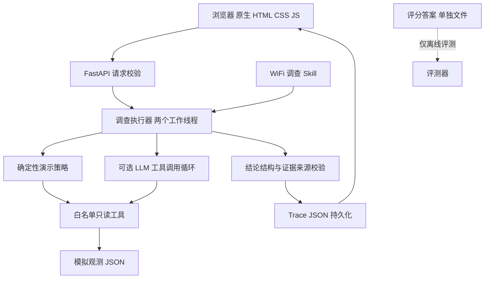

# 校园 WiFi 调查系统后端 HLD

版本：1.0（第一阶段 MVP）  
日期：2026年11月4日  
成员：刘俊伟 23211354、吴睿娜 23211361  
指导教师：陈一帅  
工作目录：C:\Users\imar\Desktop\AI_net_work\wifi_course

## 1 目标与范围

依据项目介绍与设计文档，实现“楼门外已连接校园 WiFi 但无法上网”的证据调查系统。第一阶段交付本机运行的前后端闭环：选择模拟案例，后端执行实际确定性检查，返回证据、反证与受限结论，前端展示并导出 Trace。

模型适配器支持 OpenAI 兼容服务的工具调用。未配置真实模型时仍可运行规则演示，二者严格标记；规则结果不能作为 LLM 实验。阶段一不要求现场测量，不自动修改设备、不扫描实际校园网，也不承诺已经查明真实楼门口根因。

## 2 架构及参考关系



参考老师示例 backend/main.py 的 FastAPI 路由、Pydantic 请求、静态页面服务与服务端模型调用结构。将其单次“生成实验室介绍”替换为调查执行器、四项网络检查和 Trace 仓储。无需 LiteLLM；当前适配器使用标准库 urllib 发送兼容请求，减少依赖。保留 FastAPI 与 Uvicorn 作为后端框架。

前端继续使用已确定的主机主页式设计。独立打开 HTML 时回放本地样例；通过本机服务打开时请求后端执行，两种来源在状态与导出中区分。当前系统单机单用户，不引入数据库、账户、多租户或任务队列。

## 3 模块职责

| 模块 | 位置 | 职责 |
| --- | --- | --- |
| API 与静态服务 | backend/app.py | 请求契约、执行调度、错误码、返回与记录脱敏 |
| 调查核心 | src/engine.py | 候选假设、规则策略或模型循环、预算及输出校验 |
| 专业工具 | src/tools.py | 查询快照、计算地址有效性、统计连通检查、对比快照 |
| 专业 Skill | skills/wifi-investigation/SKILL.md | 场景、理论、步骤、反证、错误与不确定性 |
| 网络观测 | data/observations.json | 10 个中性命名的模拟案例，室内外对照 |
| 评分标准 | data/ground_truth.json | 仅评测使用，不作为模型或接口输出 |
| 运行记录 | results/web_traces/ | 每次后端执行的不可预测 UUID 文件名 |

## 4 数据与工具

快照包含设备编号、位置、时间、SSID、BSSID、信号值、IP、前缀、网关、DNS、认证和分层检查。所有数据标记 synthetic。未观测使用 null，不能换成失败样本；有效样本比例与检查成功率使用各自分母。

| 工具 | 输入 | 输出与边界 |
| --- | --- | --- |
| get_snapshot | case_id、location | 仅给定案例的观测和模拟来源 |
| check_ip_config | case_id、location | 使用 ipaddress 计算格式、地址类别与网关同网段关系；特殊路由只标疑点 |
| analyze_connectivity | case_id、location | 网关、HTTPS、DNS、ICMP 的有效数与成功率；warnings 与冲突分开 |
| compare_snapshots | case_id | 同设备、时间差、BSSID/配置变化及可比性限制 |

工具只能读取固定观测文件，无任意路径、命令执行或实际探测入口。未知名称、额外参数、错误类型及跨案例访问拒绝。HTTPS 成功只证明特定检查目标可达；ICMP 失败不能单独证明断网，BSSID 改变不能单独证明漫游失败。

## 5 接口契约

| 方法与路径 | 用途 | 主要返回 |
| --- | --- | --- |
| GET / | 前端主页 | HTML |
| GET /style.css、/app.js、/data.js | 固定静态资源 | CSS/JS |
| GET /health | 服务版本和模型配置是否存在 | status、version、model_configured |
| GET /cases | 观测目录 | synthetic、cases，不含评分答案 |
| POST /investigate | 执行调查 | trace_id、trace |
| GET /traces | 记录目录 | id、source、name |
| GET /traces/{id} | 读取保存记录 | 经过脱敏的 Trace |
| GET /results | 可用结果汇总文件 | files、notice |

调查请求示例：

```json
{"case_id":"W01","question":"门外连上WiFi但网页打不开，请调查。","mode":"demo","group":"C"}
```

case_id 为 W 加两位数字且必须存在。mode 仅 demo/llm，group 仅 A/B/C，规则演示仅接受 C，避免将演示伪装成对照实验。question 可省略，提供时去除两端空白并限制 1–4000 字符。未知字段拒绝，不接收前端密钥。

成功响应中的 trace 包括 status、backend、case_id、group、question、hypotheses、calls、conclusion、elapsed_seconds、trace_id、created_at，以及适用时的 Skill 哈希和模型轮次。时间保存为带时区的 UTC，界面可按需要转换显示。

conclusion 包含 label、assessment、evidence、counterevidence、limitations、recommendations。证据的 source_ids 必须指向本次成功工具调用；直接模型组只能引用允许的原始观测来源。格式合格不等于语义正确，专业正确性仍需独立评测。

## 6 执行及错误处理

1. API 校验请求及案例，向两线程执行池提交同步调查，避免阻塞健康检查。
2. 核心读取安全观测；C 组实际读取 Skill 并计算哈希。
3. demo 执行固定的真实工具链；llm 由模型选择工具、处理返回并形成 JSON 结论。
4. 核验输出及证据引用，产生 completed 或 failed；缺失模型、超时、错误返回均不自动回退规则。
5. 生成 trace_id、时间，脱敏后持久化，再返回前端。

API 模式最多 8 轮、20 次工具调用，单次网络请求最多 30 秒，总调查预算约 120 秒；这些是调用边界检查，不保证远端服务能取消已发起请求。两个执行线程适合本机演示，排队、速率限制和生产级负载治理不属于本阶段。

HTTP 422 表示请求不合法，404 表示案例或记录不存在，400 表示非法记录标识。调查执行失败仍返回 HTTP 200 和 trace.status=failed，表示请求已被接收且失败记录已保存；前端必须判断业务状态。意外内部异常不向前端暴露堆栈。文件写入失败不能宣称成功保存。

记录读取限制为 codex/web_traces 固定目录和字母数字编号，resolve 后校验目录。请求校验错误不回显 input；返回和存储去除敏感字段，并替换当前配置的密钥。此措施用于本机课程运行，不代替生产环境完整的机密治理。

## 7 配置与部署

使用 Python 3.12 验证，主要依赖锁定在 requirements.txt。运行命令：

```powershell
python -m pip install -r requirements.txt
python -m uvicorn backend.app:app --host 127.0.0.1 --port 8765
```

从项目根目录执行，浏览器访问 http://127.0.0.1:8765。start.ps1 优先使用项目 .venv，其次可使用已准备的 .runtime。模型配置通过 NETAI_BASE_URL、NETAI_MODEL、NETAI_API_KEY 环境变量传入；.env.example 仅说明，不自动加载。密钥不放网页、提交包或浏览器 localStorage。

本地数据和 Trace 均在工程内，复制完整项目即可迁移；.runtime 是开发便利目录，正式提交包不携带机器相关环境。启动时保持仅监听本机。无真实 API 服务也能完成后端工具演示；该条件不等于真实模型性能已验证。

## 8 第一阶段验收

工具回归覆盖地址计算、缺失样本、协议限制、快照不可比、非法参数、跨案例调用、预算和输出引用。API 检查覆盖首页资源、10 案目录、调查与 Trace 往返、422/404/400、模型缺配置失败、脱敏及健康检查不受同步调查阻塞。

浏览器联调使用 HTTP 页面而非 file 回放，检查点击后确实请求 POST /investigate、返回新 trace_id、前端显示实际证据、保存记录可再读、导出可用。验证 W02/W04 不再把 null 提示当成冲突。测试中的 mock 模型只用于接口边界，不算真实 LLM 实验。

交付包括 HLD、完整前后端代码、Skill、模拟数据、运行说明和联调记录。后续阶段再补全 C 组真实模型对照、人工语义评分及课程实验报告，本阶段不预填成功率。
